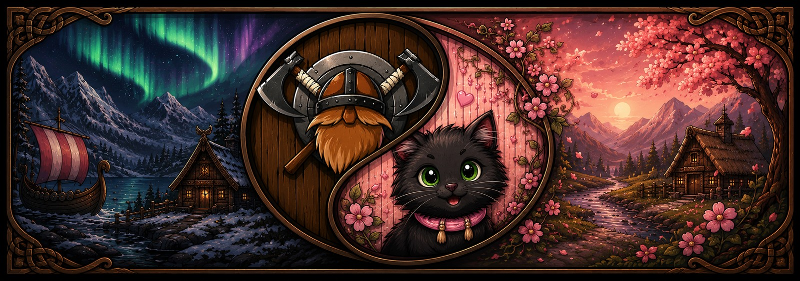
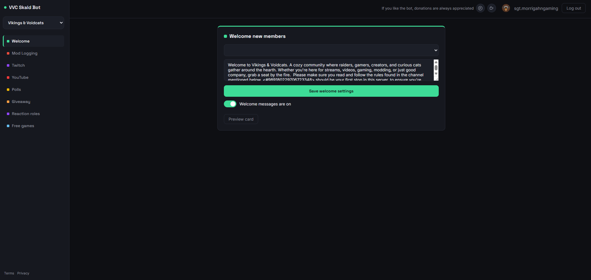
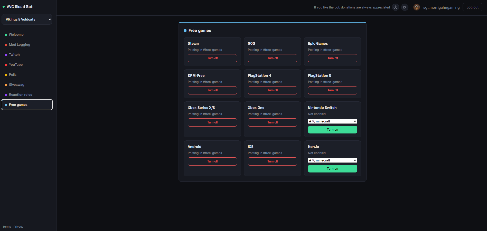
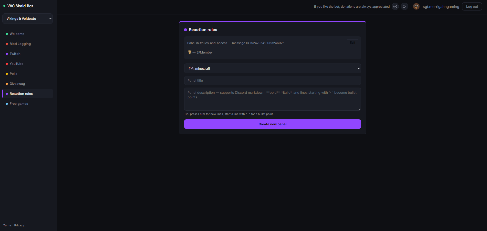
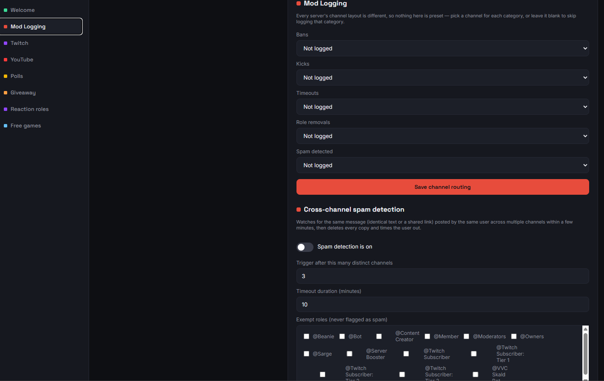

<p align="center">
  
</p>

<p align="center">
  <a href="https://top.gg/bot/1524428870600626357"></a>
  <a href="LICENSE"></a>
  
</p>

# VVC Skald Bot

A free, fully open-source, self-hosted Discord community bot. No premium tiers, no paywalls,
no per-server limits — everything in this repo is available to anyone who wants to run it.

Built around one idea: keep an active, cozy community server running smoothly without needing
five different bots plugged into it. Skald Bot is designed to be the **only** bot your server
needs.

## Features

- **Twitch live announcements** — Helix API, batched requests, no per-server subscription limit
- **YouTube upload announcements** — public RSS feed, no API key required
- **Free games alerts** — Epic's official promotions feed plus 11 more platforms (Steam, GOG, and
  others) via GamerPower, individually toggleable per server
- **Reaction roles** — button-based panels, full create/edit/delete support from the dashboard
- **Welcome cards** — generated image cards on member join, with optional DM
- **Polls** — native Discord poll creation with a modal-driven builder, live vote bars, auto-close
- **Giveaways** — click-to-enter, role-gating, booster bonus entries, auto-close, winner claim
  buttons
- **Mod action logging** — passive audit-log tracking for bans/kicks/timeouts/role removals, each
  routed to its own channel
- **Cross-channel spam detection** — catches compromised accounts blasting the same message or
  link across multiple channels, with configurable thresholds and auto-timeout
- **Web dashboard** — manage every feature above through a browser instead of memorizing slash
  commands, secured with Discord OAuth2 and per-server permission checks

Everything is manageable from the dashboard. Slash commands remain available in parallel if you
prefer them.

## Screenshots

<p align="center">
  
  
</p>
<p align="center">
  
  
</p>

*(Drop your PNGs into `assets/` using the filenames above, or rename the `src` attributes to match
whatever you save them as — swap in as many or as few as you like.)*

## Requirements

- Node.js 22+
- A Discord bot application
- A Twitch Developer application (free, only needed for Twitch tracking)
- Optionally: a domain + reverse proxy (nginx, Caddy, etc.) if you want the web dashboard
  reachable from outside your machine

## 1. Create the Discord bot

1. Go to the [Discord Developer Portal](https://discord.com/developers/applications) →
   **New Application**.
2. Under **Bot**, click **Reset Token** and copy it → this is `DISCORD_TOKEN`.
3. On the **General Information** page, copy the **Application ID** → this is `DISCORD_CLIENT_ID`.
4. Under **Bot → Privileged Gateway Intents**, enable:
   - **Server Members Intent** (welcome cards, role management)
   - **Message Content Intent** (required for the cross-channel spam detector)
   - Presence Intent is **not** used — leave it off.
5. Under **OAuth2 → URL Generator**:
   - Scopes: `bot`, `applications.commands`
   - Bot permissions: `View Channels`, `Send Messages`, `Embed Links`, `Attach Files`,
     `Add Reactions`, `Manage Roles`, `Read Message History`, `Manage Messages`,
     `Moderate Members`, `View Audit Log`
   - Copy the generated URL — this is your invite link.

## 2. Create the Twitch app (optional, for `/twitch`)

1. Go to the [Twitch Developer Console](https://dev.twitch.tv/console/apps) →
   **Register Your Application**.
2. OAuth Redirect URL can be `https://localhost` (unused — this bot only uses the
   app/client-credentials flow, not user login).
3. Category: "Application Integration" (or similar).
4. Copy the **Client ID**, then generate and copy a **Client Secret**.

If you skip this, every other feature still works fully; `/twitch add` will just tell users
Twitch isn't configured.

## 3. Configure and install

```bash
cp .env.example .env
# fill in DISCORD_TOKEN, DISCORD_CLIENT_ID, and (optionally) TWITCH_CLIENT_ID / TWITCH_CLIENT_SECRET

npm install
```

## 4. Register the slash commands

```bash
npm run deploy-commands
```

Global commands can take up to an hour to show up everywhere the first time. For instant testing
in one server while developing, set `GUILD_ID` in `.env` (right-click your server → Copy Server ID,
with Developer Mode on) and run:

```bash
npm run deploy-commands:guild
```

## 5. Run it

```bash
npm start
```

Or with Docker (recommended for production):

```bash
docker compose up -d --build
```

The SQLite database lives at `./data/bot.sqlite` (or wherever `DB_PATH` points) — back this up if
you care about preserving subscriptions, panels, poll/giveaway history, and mod-log configuration.

## 6. Web dashboard (optional)

The dashboard runs in-process with the bot — no separate service to manage. To enable it, set in
`.env`:

```
WEB_ENABLED=true
WEB_PORT=3000
WEB_PUBLIC_URL=https://your-domain-or-ip
DISCORD_CLIENT_SECRET=   # OAuth2 client secret, from the same Developer Portal app (different from the bot token)
SESSION_SECRET=          # generate with: node -e "console.log(require('crypto').randomBytes(32).toString('hex'))"
```

You'll also need to add `WEB_PUBLIC_URL + /auth/discord/callback` as a valid OAuth2 redirect under
**OAuth2 → Redirects** in the Developer Portal.

If you want it reachable at a real domain, put nginx (or similar) in front of it with a
Let's Encrypt certificate — the dashboard itself just listens on plain HTTP on `WEB_PORT`.

## Commands

All commands require the **Manage Server** permission.

| Command | Description |
|---|---|
| `/twitch add \| remove \| list` | Track/untrack Twitch streamers, with optional role ping and custom message |
| `/youtube add \| remove \| list` | Track/untrack YouTube channels (accepts `@handle`, full URL, or channel ID) |
| `/freegames enable \| disable \| list` | Subscribe/unsubscribe this server to free-game alerts, per platform |
| `/reactionroles create-panel \| edit-panel \| add \| remove` | Build and manage reaction role panels |
| `/welcome setup \| test \| enable \| disable` | Configure welcome cards and optional join DM |
| `/poll create \| close \| results \| list` | Native Discord polls with a guided builder |
| `/giveaway create \| close \| results \| list` | Giveaways with role-gating, booster bonus entries, auto-close |
| `/help` | Show bot info in Discord |

Mod action logging and spam detection are dashboard-only (no commands) — every server's channel
layout is different, so there are no hardcoded defaults; you pick the channels yourself.

Custom messages support placeholders:
- Twitch: `{streamer}`, `{title}`, `{game}`, `{url}`
- YouTube: `{channel}`, `{title}`, `{url}`
- Welcome DM: `{user}`, `{server}`

## Resource footprint

- **CPU/RAM**: trivial — comfortably runs on a Raspberry Pi or a cheap VPS.
- **Bandwidth**: small JSON/XML/RSS responses per poll cycle, well under 1 GB/day even at scale.
- **Disk**: SQLite grows by roughly one row per subscription/panel/poll/giveaway — negligible.
- **No inbound ports required** for the bot itself — it only makes outbound requests and polls on
  an interval. The dashboard is the only optional piece that needs an inbound port if you expose
  it externally.

## Data & privacy

- All guild data (subscriptions, panels, mod-log config, etc.) is automatically deleted when the
  bot is removed from a server.
- The spam detector reads message content in-memory only for fingerprinting — nothing is
  persisted to disk.
- See `/tos` and `/privacy` on your running dashboard for the full Terms of Service and Privacy
  Policy.

## Support the project

This bot is free and always will be — no premium tier, no feature paywall. If you'd like to
support development anyway:

- PayPal: [paypal.me/MorrigahnGaming](https://paypal.me/MorrigahnGaming)
- Ko-fi: [ko-fi.com/sgt_morrigahngaming](https://ko-fi.com/sgt_morrigahngaming)

## Project structure

```
src/
  index.js                    Bot entry point — wires up commands, pollers, handlers
  config.js                   Env var loading
  db.js                       SQLite schema + all queries
  deploy-commands.js          Registers slash commands globally
  deploy-commands-guild.js    Registers slash commands to one guild (instant, for testing)
  commands/
    freegames.js, giveaway.js, help.js, poll.js, reactionroles.js,
    twitch.js, welcome.js, youtube.js
  services/
    announcer.js               Embed building + sending (Twitch/YouTube)
    epicClient.js               Epic's official free-promotions feed
    freeGamesPoller.js          Free games polling loop
    gamerPowerClient.js         GamerPower API wrapper (Steam/GOG/+9 more)
    giveawayCloser.js / giveawayInteractions.js
    guildCleanupHandler.js      Deletes all guild data on bot removal
    modLogHandler.js            Audit-log listener (bans/kicks/timeouts/role removals)
    pollCloser.js / pollInteractions.js
    reactionRoleHandler.js
    spamDetector.js             Cross-channel spam fingerprinting + auto-timeout
    statusRotator.js            Rotates the bot's custom status
    twitchClient.js / twitchPoller.js
    welcomeHandler.js
    youtubeClient.js / youtubePoller.js
  utils/
    emoji.js, giveawayFormat.js, logger.js, pollFormat.js, welcomeCard.js
  web/
    server.js                   Express app, OAuth routes, static hosting
    api.js                       Dashboard REST API (all guild-scoped routes)
    authMiddleware.js
    discordOAuth.js
    public/
      index.html                 Dashboard UI
      privacy.html, tos.html      Public legal pages
```

## Troubleshooting

- **"This bot instance has not been configured with Twitch API credentials yet"** — set
  `TWITCH_CLIENT_ID` and `TWITCH_CLIENT_SECRET` in `.env` and restart.
- **Commands don't show up in Discord** — global commands take up to an hour; use
  `npm run deploy-commands:guild` with `GUILD_ID` set for instant testing.
- **YouTube channel not found** — try pasting the full channel URL (e.g.
  `https://www.youtube.com/@handle`) instead of just the handle or name.
- **No announcements coming through** — check the bot has permission to view and send messages in
  the configured announcement channel, and check the console logs for errors.
- **Welcome cards not appearing** — make sure Server Members Intent is enabled in the Developer
  Portal, matching what you enabled in code.
- **Spam detector not catching anything / catching too much** — thresholds, timeout duration, and
  exempt roles are all configurable per server from the Mod Logging tab in the dashboard.
- **Dashboard shows "No manageable servers with this bot installed"** — you're logged in, but the
  bot isn't in any server where you have Manage Server permission. Use the "Add to Server" button
  on the same page.
- **Reaction role add fails with a hierarchy error** — the bot's own role must sit above any role it's assigned to hand out, in Server Settings → Roles. This is a Discord-enforced rule, not a bot limitation.
